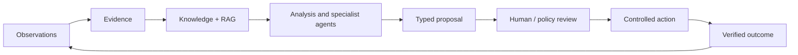

# SENTINEL — Building Intelligence

> **Your buildings talk. We help you listen.**

SENTINEL is an intelligence layer for buildings. It brings together BMS/SCADA telemetry, equipment context, operational observations and AI-assisted analysis so people can make better decisions about building performance.

```text
Observation → Evidence → Knowledge → Decision → Action → Outcome
```

The public repository is a curated showcase of the platform’s architecture, demo workflows and selected implementation patterns. The complete private product and deployment environment are not represented as a single open-source package.

## What SENTINEL helps with

- **Understand equipment** across sites, systems and points
- **See building health** through alarms, trends, telemetry and evidence
- **Detect problems earlier** with anomaly and predictive-maintenance workflows
- **Improve energy performance** with explainable recommendations
- **Connect humans and AI** through reviewable workflows, APIs and MCP tools

## The core idea

AI should not jump directly from a prompt to physical action. SENTINEL separates the stages:

1. **Observation** — telemetry, complaints, documents or model signals
2. **Evidence** — source records, timestamps, equipment identity and provenance
3. **Knowledge** — canonical building and equipment context
4. **Decision** — a recommendation or typed proposal
5. **Action** — an approved workflow or controlled adapter call
6. **Outcome** — verification, feedback and future learning

This makes recommendations easier to inspect, explain and govern.

## Architecture



At the platform level, the public implementation includes:

- React/Vite cockpit interfaces
- FastAPI services and REST/SSE APIs
- PostgreSQL/Supabase data storage
- BMS/IoT adapter boundaries
- RAG, embeddings and equipment knowledge structures
- predictive-maintenance and energy-analysis services
- authenticated MCP tool surfaces
- tests, deployment examples and operational documentation

## Try the demo path

The recommended first experience is the local demo mode. It uses synthetic/demo data rather than a live building or external BMS connection.

```bash
git clone https://github.com/Bederf/sentinel-ai.git
cd sentinel-ai
cp .env.example .env
./quickstart.sh
```

Then open the local cockpit and API documentation described in the [quick-start guide](docs/01-getting-started/quick-start.md).

For a guided walkthrough, see the [demo guide](docs/01-getting-started/demo-guide.md). For the system model, start with the [architecture overview](docs/02-architecture/system-overview.md).

## Selected public walkthroughs

| Area | Start here |
|---|---|
| Building intelligence model | [System overview](docs/02-architecture/system-overview.md) |
| Local setup | [Quick start](docs/01-getting-started/quick-start.md) |
| Product demonstration | [Demo guide](docs/01-getting-started/demo-guide.md) |
| AI recommendations | [AI recommendation system](docs/08-ai-ml/ai-recommendation-system.md) |
| Knowledge and retrieval | [RAG documentation](docs/08-ai-ml) |
| Security and governance | [Security documentation](docs/09-security/README.md) |
| API surface | [API reference](docs/03-api-reference/) |

## Safety boundary

SENTINEL is designed around trust-gated automation:

- AI outputs are recommendations or proposals, not automatic authority.
- Material actions require policy and/or operator approval.
- Evidence and provenance are retained for review.
- Demo mode is separate from live BMS/SCADA operation.
- Integrations and capabilities must be qualified for their specific environment.

The public project should be read as a platform showcase and reference implementation. It is not a claim that every documented integration is active in every deployment.

## Technology

**Backend:** Python, FastAPI, PostgreSQL, Supabase, Redis
**Frontend:** React, Vite, TypeScript
**AI/data:** RAG, embeddings, vector search, knowledge graphs, model gateways
**Integration:** BACnet, Modbus, Niagara/Desigo, MQTT, MCP, SSE
**Operations:** Docker, Linux, systemd, monitoring and CI/CD

## Project status

SENTINEL is an actively evolving platform with different capabilities at different maturity levels: demonstrated, shadow-mode, qualification-gated and deployment-specific. The public repository focuses on the ideas and implementation sections that are useful for engineers, operators and collaborators to explore.

## Contributing

The most useful public contributions are documentation improvements, demo-mode fixes, safe test fixtures, adapter abstractions, observability and reproducible local workflows. Please avoid submitting credentials, customer/site data or private deployment details.

See [CONTRIBUTING.md](CONTRIBUTING.md) and [SECURITY.md](SECURITY.md).

## Related public work

- [ARC — Applied AI Agent Platform](https://github.com/Bederf/arc-ai-agent-platform) — governed AI agent reference workflow
- [SENTINEL Home Assistant Add-on](https://github.com/Bederf/sentinel-ha-addon) — solar telemetry and energy alerts

## License

Apache License 2.0. See [LICENSE](LICENSE).
